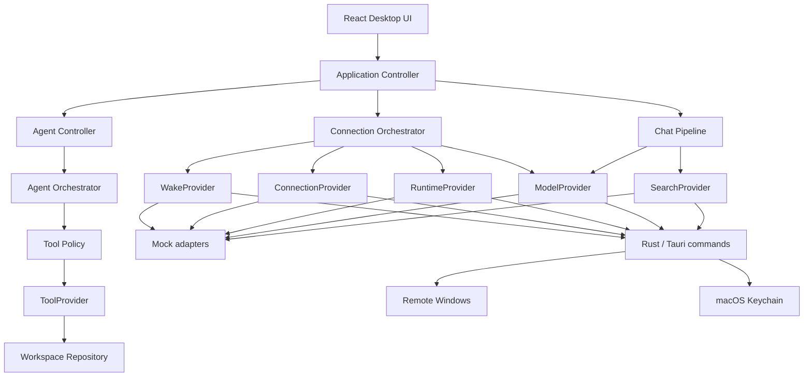
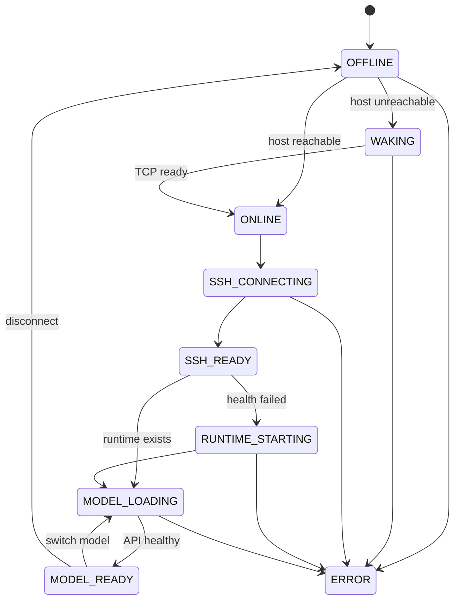

# Architecture

## 원칙

UI는 SSH나 llama.cpp를 직접 알지 않습니다. `ConnectionOrchestrator`가 작은 provider contract를 조합하고, Mock/Tauri bundle이 같은 계약을 구현합니다. 설정과 credential은 서로 다른 저장 경계를 사용합니다.

## 구성 요소

| 계층 | 책임 | 주요 위치 |
|---|---|---|
| Presentation | chat/sidebar/model/settings/log UI | `src/components` |
| Application | 대화/연결 controller와 독립 agent controller | `src/hooks/useAppController.ts`, `src/hooks/useAgentController.ts` |
| Domain | 타입, 상태 전이, 기본 registry | `src/domain` |
| Providers | wake/connection/runtime/model/search 계약과 adapter | `src/services/providers` |
| Chat pipeline | 검색 routing, capability fallback, timeout/cancel, deep review | `src/services/chatPipeline.ts` |
| Agent runtime | bounded loop, approval, normalized response, tools | `src/services/agentOrchestrator.ts`, `toolProvider.ts`, `toolPolicy.ts` |
| Native | UDP WOL, SSH tunnel, process lifecycle, workspace FS, HTTP SSE | `src-tauri/src/lib.rs` |
| Configuration | 모델과 launch profile | `config` |

## Data flow

사용자 메시지는 먼저 대화에 durable하게 반영된 뒤 준비 흐름을 통과합니다. `ChatPipeline`은 `off/auto/on` 검색 routing과 모델 capability에 따른 reasoning fallback을 결정합니다. 검색 결과는 정규화·중복 제거 후 system context로 주입되고 citation metadata로 저장됩니다. `deep-review`는 Draft → Critique → Final Revision을 실행하되 UI에는 단계 상태와 최종 답변만 노출합니다. 모델이 준비되면 `ModelProvider.streamChat`이 token을 callback으로 전달하며 각 token이 assistant message에 누적됩니다. 완료/실패/취소/timeout 시 `pending` 상태가 정리됩니다.

Agent task는 별도 `AgentOrchestrator`가 처리합니다. Model adapter가 raw OpenAI/Qwen response를 `AgentResponse`로 정규화하고, policy가 tool request를 AUTO/ASK/DENY로 판정한 뒤에만 `ToolProvider`를 호출합니다. Workspace repository는 모든 파일 경계를 canonical root 아래로 제한합니다. `ConnectionOrchestrator`와 기존 Chat controller에는 agent loop를 합치지 않습니다.

## State machine

모든 network wait는 retry limit와 backoff를 가지며 무한 재시도하지 않습니다.

## 확장 지점

새 플랫폼은 provider contract 구현으로 추가합니다. 예를 들어 Linux 연결은 `ConnectionProvider`, Ollama는 `RuntimeProvider`와 `ModelProvider`, ipTIME 인증 wake는 별도 `WakeProvider`만 구현하면 됩니다. UI와 상태 머신은 유지됩니다.
