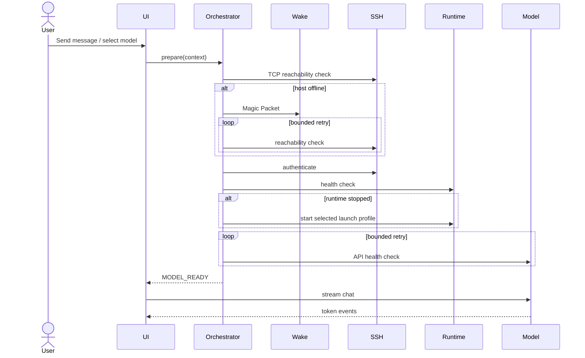

# Connection Flow

Mock Mode는 동일한 sequence를 짧은 지연과 메모리 상태로 재현합니다. 실제 모드는 Tauri IPC를 통해 Rust backend만 network/credential에 접근합니다.

모델 변경 시 conversation은 유지하고 이후 요청부터 새 `modelId`를 사용합니다. 현재 컨텍스트는 이전 user/assistant messages 전체를 새 모델로 전달합니다. production 단계에서는 context window token budgeting과 system notice가 추가되어야 합니다.
